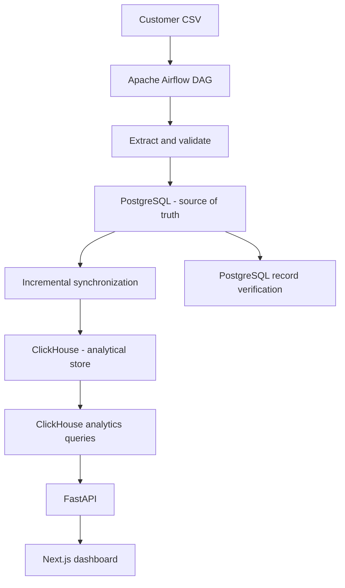
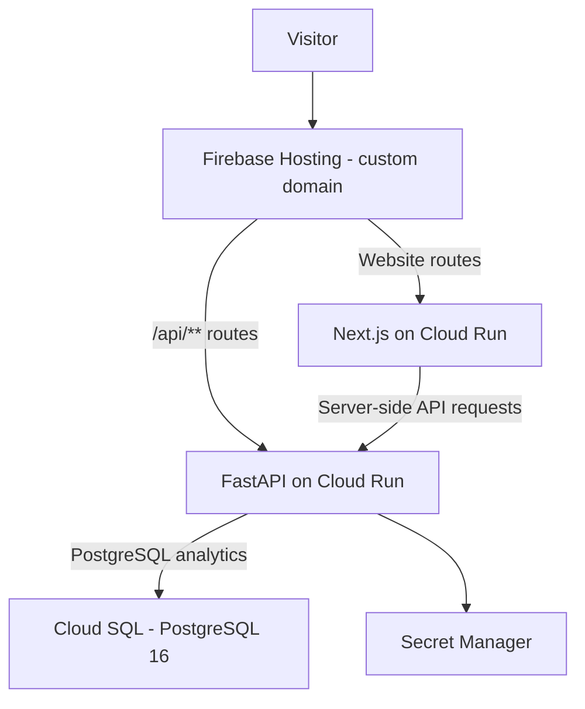

<div align="center">
  

  # Abdulla Chowdry

  **AI + Data Engineer**

  Building intelligent systems, reliable data platforms and production-oriented AI applications.

  [Portfolio](https://abdullachowdry.com) · [LinkedIn](https://www.linkedin.com/in/chowdry-abdulla-178484156/) · [GitHub](https://github.com/abdullachowdry750) · [Email](mailto:abdullachowdry@gmail.com)

  
  
  
</div>

---

## Overview

I'm an AI and Data Engineer with 5+ years of experience building enterprise data platforms, machine learning systems and applied AI solutions. My work spans data ingestion and orchestration, backend services, LLM-based applications, cloud infrastructure and production reliability.

This repository contains the source code for my personal portfolio and a working Enterprise Data Platform implementation. It demonstrates engineering patterns across data quality, incremental processing, operational and analytical storage, API development, containerization and cloud deployment.

**Live portfolio:** [https://abdullachowdry.com](https://abdullachowdry.com)

## Featured project: Enterprise Data Platform

**Status: Working implementation**

A data ingestion and analytics platform that ingests customer records from CSV, validates and normalizes them, synchronizes them incrementally into PostgreSQL and ClickHouse, verifies records and exposes analytics through FastAPI.

### Local data-platform architecture



### Capabilities

- **Orchestration:** Apache Airflow DAG with task dependencies, retries and failure handling.
- **Data quality:** CSV extraction, normalization and customer-record validation.
- **Incremental processing:** deterministic SHA-256 record hashes; insert new records, update changed records and skip unchanged records.
- **Operational storage:** PostgreSQL as the source of truth.
- **Analytical storage:** ClickHouse using a versioned `ReplacingMergeTree` table and `FINAL` reads.
- **Verification:** record-level hash checks across PostgreSQL and ClickHouse.
- **Auditability:** ingestion audit records with source, run status and insert/update/unchanged metrics.
- **API and analytics:** FastAPI endpoints for profile, projects, health and customer analytics.
- **Testing:** validation, incremental-ingestion and PostgreSQL integration tests.

### Sample analytics

The portfolio dashboard uses **five synthetic demonstration customer records**. It shows total customers, unique cities, first and latest signup dates, city distribution and monthly signups. These are sample records, not production customer data.

## Additional project concepts

The following ideas are shown in the portfolio as planned work; they should not be interpreted as completed implementations.

| Project | Description | Status |
|---|---|---|
| Enterprise RAG Platform | Document ingestion, retrieval, hybrid search and LLM-based generation | Planned |
| ModelOps Platform | Experiment tracking, model lifecycle, deployment and monitoring | Planned |

## Production deployment architecture

The public portfolio is hosted on Google Cloud Platform. Firebase Hosting provides the custom-domain entry point and routes requests to the two Cloud Run services.



### Cloud components

| Component | Service | Purpose |
|---|---|---|
| Domain and DNS | Cloudflare | Domain registration and DNS management |
| Hosting and routing | Firebase Hosting | HTTPS custom domain and path-based rewrites |
| Frontend | Next.js on Cloud Run | Portfolio website and case-study pages |
| Backend | FastAPI on Cloud Run | Profile, projects, health and analytics API |
| Database | Cloud SQL for PostgreSQL 16 | Managed database used by the hosted analytics API |
| Secrets | Secret Manager | Runtime database password |
| Container images | Artifact Registry | Stores versioned Linux AMD64 images |
| Logs | Cloud Logging | Cloud Run service logs |

**Region:** `asia-south1` (Mumbai).

The hosted FastAPI service uses the PostgreSQL analytics implementation against Cloud SQL. The local Docker Compose environment retains ClickHouse and the ClickHouse analytics implementation. Airflow is currently self-managed in the local Docker Compose environment; it is not described as a continuously running GCP service.

## API reference

The FastAPI application exposes these GET endpoints:

| Endpoint | Description |
|---|---|
| `/` | API welcome response |
| `/api/health` | Service health check |
| `/api/profile` | Professional profile data |
| `/api/projects` | Portfolio project data |
| `/api/analytics/customers` | Customer summary, city distribution and monthly signups |

Example health check:

```bash
curl https://abdullachowdry.com/api/health
```

Expected response:

```json
{
  "status": "healthy"
}
```

Example analytics request:

```bash
curl https://abdullachowdry.com/api/analytics/customers
```

## Technology stack

| Area | Technologies |
|---|---|
| Languages | Python, SQL, TypeScript |
| AI and GenAI | LLM applications, Agentic AI, RAG, LangGraph, Vertex AI Gemini |
| Machine learning | scikit-learn, MLflow |
| Data engineering | Apache Airflow, Pandas, Kafka |
| Databases | PostgreSQL, ClickHouse |
| Backend | FastAPI, REST APIs, SQLAlchemy |
| Frontend | Next.js, React, Tailwind CSS |
| Cloud | Google Cloud Platform, Cloud Run, Cloud SQL, BigQuery, Dataflow |
| Infrastructure | Docker, Docker Compose, Artifact Registry, Firebase Hosting |

## Repository structure

```text
abdulla-portfolio/
├── backend/
│   ├── main.py
│   ├── schemas.py
│   ├── requirements.txt
│   └── Dockerfile
├── frontend/
│   ├── public/
│   │   ├── images/
│   │   ├── logo.svg
│   │   └── resume.pdf
│   ├── src/app/
│   ├── src/lib/
│   ├── Dockerfile
│   └── next.config.ts
├── projects/
│   └── enterprise-data-platform/
│       ├── dags/
│       ├── data/sample/
│       ├── docs/
│       ├── scripts/
│       ├── src/
│       │   ├── analytics/
│       │   ├── ingestion/
│       │   ├── quality/
│       │   └── storage/
│       ├── tests/
│       └── docker-compose.yml
├── firebase.json
├── .firebaserc
├── .dockerignore
└── README.md
```

## Local development

### Prerequisites

- Docker Desktop
- Node.js and npm
- Python (the container image uses Python 3.12)
- Git

### 1. Clone the repository

```bash
git clone https://github.com/abdullachowdry750/abdulla-portfolio.git
cd abdulla-portfolio
```

### 2. Configure the data platform

```bash
cd projects/enterprise-data-platform
cp .env.example .env
```

Edit `.env` with local development credentials. Do not commit `.env` or place real credentials in source control.

Start the local services from the repository root:

```bash
cd ../..
docker compose -f projects/enterprise-data-platform/docker-compose.yml up -d --build
```

The Compose project starts PostgreSQL, ClickHouse, the FastAPI API service and Airflow services. Typical local endpoints are:

| Service | Local address |
|---|---|
| Portfolio frontend | `http://localhost:3000` |
| FastAPI in Compose | `http://localhost:8002` |
| Airflow UI | `http://localhost:8080` |
| PostgreSQL | `localhost:5432` |
| ClickHouse HTTP | `localhost:8123` |
| ClickHouse native | `localhost:9000` |

### 3. Start the frontend

In a separate terminal:

```bash
cd frontend
npm ci
```

Create `frontend/.env.local` for local development:

```env
NEXT_PUBLIC_API_URL=http://localhost:8002
```

Start Next.js:

```bash
npm run dev
```

Open [http://localhost:3000](http://localhost:3000).

### 4. Run tests

Create and activate the Enterprise Data Platform virtual environment, install the project requirements, then run the tests:

```bash
cd projects/enterprise-data-platform
python -m venv .venv
source .venv/bin/activate
pip install -r requirements.txt
python -m pytest tests/ -v
```

The PostgreSQL integration tests use an isolated test database. Configure test credentials deliberately; never point destructive integration tests at a production database.

## Container builds

Build the backend image from the repository root because its Dockerfile copies both `backend/` and `projects/enterprise-data-platform/`:

```bash
docker buildx build \
  --platform linux/amd64 \
  --file backend/Dockerfile \
  --tag portfolio-api:local \
  .
```

Build the frontend image from the `frontend/` directory, passing the API URL at build time because `NEXT_PUBLIC_` variables are embedded during the Next.js build:

```bash
cd frontend
docker buildx build \
  --platform linux/amd64 \
  --build-arg NEXT_PUBLIC_API_URL=https://portfolio-api-175289070403.asia-south1.run.app \
  --file Dockerfile \
  --tag portfolio-frontend:local \
  .
```

For production deployments, push versioned images to Artifact Registry and deploy them to the existing Cloud Run services. Do not bake database credentials into an image or Docker build argument.

## Security notes

- Local `.env` and `.env.local` files are excluded from Git and Docker build contexts.
- The hosted API receives the PostgreSQL password from Secret Manager at runtime.
- Cloud Run uses a dedicated runtime service account with Cloud SQL connectivity and secret-access permissions.
- The hosted API connects to Cloud SQL through the Cloud Run Cloud SQL integration.
- The dashboard uses synthetic sample data. Do not add private, customer-identifying or production data to this public repository.
- The downloadable resume is publicly accessible as `frontend/public/resume.pdf`; review the contact details in it before publishing.

## Contact

**Abdulla Chowdry** · AI + Data Engineer

- Website: [abdullachowdry.com](https://abdullachowdry.com)
- Email: [abdullachowdry@gmail.com](mailto:abdullachowdry@gmail.com)
- LinkedIn: [linkedin.com/in/chowdry-abdulla-178484156](https://www.linkedin.com/in/chowdry-abdulla-178484156/)
- GitHub: [github.com/abdullachowdry750](https://github.com/abdullachowdry750)

---

<div align="center">
  <sub>Designed and built by Abdulla Chowdry · AI + Data Engineering Portfolio</sub>
</div>
